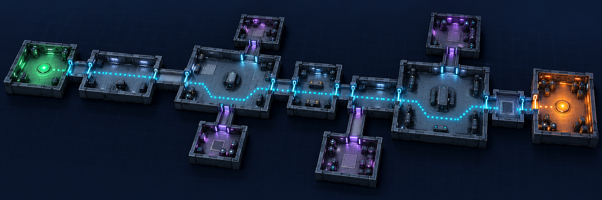
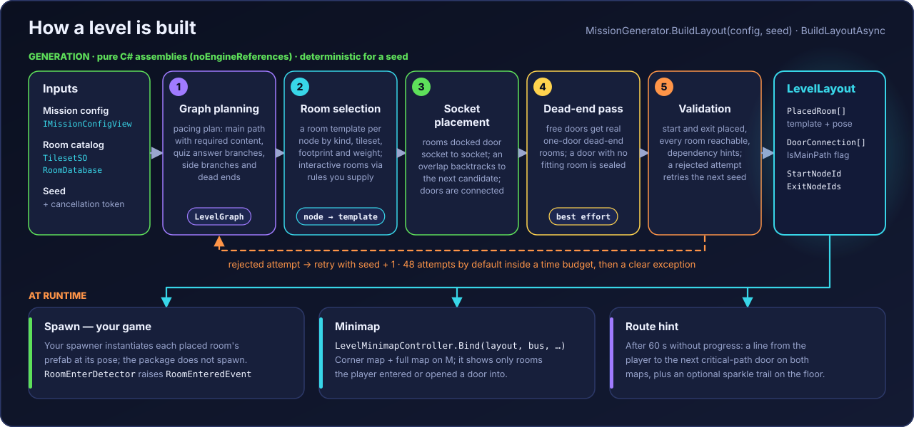
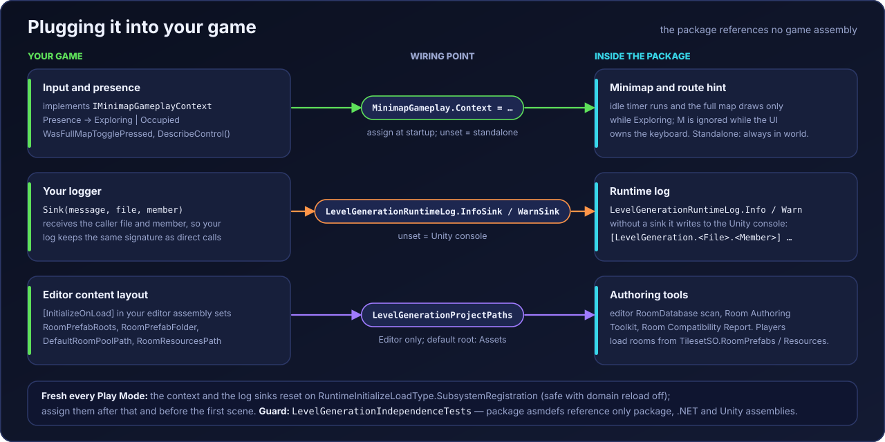
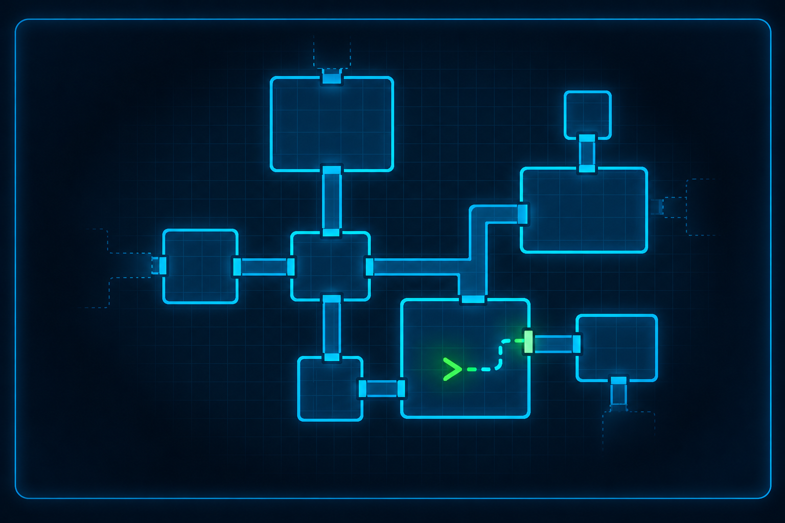

<p align="center">
  
</p>

#  Neoxider LevelGeneration

**Door-socket procedural level generation for Unity.** Give it a mission description, a catalog of
authored room prefabs and a seed; get back a validated layout where rooms are docked door to door, the
main path to the exit is known, and a minimap with a route hint already knows how to draw it.

[](https://unity.com/releases/editor)
[](LICENSE.md)
[](CHANGELOG.md)

<sub>
<a href="#why">Why</a>&nbsp;&nbsp;•&nbsp;
<a href="#what-you-get">What you get</a>&nbsp;&nbsp;•&nbsp;
<a href="#how-a-level-is-built">Pipeline</a>&nbsp;&nbsp;•&nbsp;
<a href="#install">Install</a>&nbsp;&nbsp;•&nbsp;
<a href="#quick-start">Quick start</a>&nbsp;&nbsp;•&nbsp;
<a href="#plugging-it-into-your-game">Integration</a>&nbsp;&nbsp;•&nbsp;
<a href="#minimap-and-route-hint">Minimap</a>&nbsp;&nbsp;•&nbsp;
<a href="#limits-and-non-goals">Limits</a>&nbsp;&nbsp;•&nbsp;
<a href="#documentation">Docs</a>
</sub>

---

## Why

Hand-placed levels do not scale, and scattering random rooms ignores pacing: where the required content
sits on the way to the exit, which branch is a side trip, and which door leads to a dead end. This package
plans the level as a graph first, then fills it with your own room prefabs and docks them physically,
door socket to door socket, backtracking when a room does not fit. Every attempt is validated before your
game sees it.

The generator is plain C# — its assemblies have no `UnityEngine` reference — and it builds a
deterministic `LevelLayout` from a config and a seed. In the Editor and in non-WebGL players
`BuildLayoutAsync` runs on a worker thread over snapshots of your Unity assets; in a WebGL player it runs
cooperatively on the main thread, yielding between stages.

---

## What you get

**Generation.** `MissionGenerator.BuildLayout` / `BuildLayoutAsync` — graph planning with pacing (main
path with mandatory content, side branches, dead ends), room selection by kind, tileset, footprint and
weight, socket placement with backtracking, door connection, a dead-end pass and validation. A rejected
attempt retries with the next seed (48 attempts by default) inside a time budget (`GenerationTimeout`,
20 s by default, or the budget of the pacing config); when nothing fits you get a `TimeoutException` or
`InvalidOperationException` that names the last issues. Diagnostics: `LastWarnings`, `LastDebugCounters`,
`DiagnosticLogSink`.

**Interactive rooms without hard-coded kinds.** The package knows no concrete quiz or puzzle room. Your
game passes its rules as `IInteractiveRoomKindRules`; a rule declares an answer layout —
`DoorPerOption` (every option is a locked door, wrong answers lead into dead ends) or `LockedExit`
(solving opens the exit). No interactive rooms? Pass `InteractiveRoomKindRules.Empty`.

**Forced main path.** `IForcedMainPathProvider` fixes the ordered rooms between start and exit; selection,
placement, closing unused doors and validation stay the same.

**Physical door docking.** A connection point is a full 3D local point taken from the `DoorSocket`
bounds; placement matches connected doors on X/Y/Z, and disabled sockets are never docked. Free doors
left after placement get real one-door dead-end rooms from the tileset, or are sealed when none fits.

**Authoring surface.** `RoomTemplate` (room prefab root), `DoorSocket`, `RoomBounds`, `SpawnPoint`,
`ObjectiveAnchor`; data assets `TilesetSO`, `RoomPoolSO`, `MissionArchetypeSO`, `LevelMinimapSettings`
(all under `Create → Neoxider → LevelGeneration`). Editor windows: `Neoxider → LevelGeneration → Room
Authoring Toolkit` and `Room Compatibility Report`, plus custom inspectors for `RoomTemplate` and
`DoorSocket`.

**Runtime.** `RoomInstance`, `RoomEnterDetector`, `DoorRoomTransitionDetector`, `MissionEndpointTrigger`;
engine-free events `RoomEnteredEvent`, `RoomCompletedEvent`, `DoorStateChangedEvent`,
`MissionEndpointTriggeredEvent` over `IRoomEventBus` (`SimpleRoomEventBus` included); an optional
`AdaptiveLevelLoadingController` that keeps only the current and nearby connected rooms active.

**Minimap and route hint.** A compact corner map and a full map that never spoil unvisited rooms, and a
hint that draws the way to the next door after the player stalls — see
[below](#minimap-and-route-hint).

---

## How a level is built

<p align="center"></p>

The diagram shows the current flow at a high level; the planners behind step 1 are an implementation
detail and may change between versions. `LevelLayout` is plain data: placed rooms with their template
id and pose, door connections with an `IsMainPath` flag, the start node and the exit nodes.

---

## Install

Unity **6000.0+**. Package Manager → *Add package from git URL*:

```text
https://github.com/NeoXider/LevelGeneration.git#v4.1.1
```

or in `Packages/manifest.json`:

```json
"com.neoxider.level-generation": "https://github.com/NeoXider/LevelGeneration.git#v4.1.1"
```

Dependencies come from the Unity registry automatically: `com.unity.render-pipelines.universal` 17.0.3
and `com.unity.nuget.newtonsoft-json` 3.2.1.

---

## Quick start

```csharp
using RedoSchool.Features.LevelGeneration.Generation.Application;
using RedoSchool.Features.LevelGeneration.Generation.Application.Pipeline;
using RedoSchool.Features.LevelGeneration.Generation.Domain.Models;
using RedoSchool.Features.LevelGeneration.Generation.Infrastructure;
using RedoSchool.Features.LevelGeneration.Runtime.Infrastructure;

// RoomTemplate prefabs and TilesetSO assets under a Resources folder named "Rooms";
// the RoomPrefabs listed in those tilesets are picked up as well.
IRoomDatabase rooms = RoomDatabase.LoadFromResources("Rooms");
ITilesetCatalog tilesets = TilesetCatalog.LoadFromResources("Rooms");
IInteractiveRoomKindRules kinds = InteractiveRoomKindRules.Empty; // no quiz rooms yet

var generator = new MissionGenerator(
    new SystemRandomRngFactory(),
    new MissionGraphBuilder(kinds),
    new RoomSelector(kinds),
    new SocketBacktrackingRoomPlacer(kinds),
    new DoorConnector(connectIncidentalDoorContacts: true),
    new LevelValidator(rooms),
    rooms,
    tilesets,
    kinds);

// mission is your IMissionConfigView: tileset id, archetype, room ranges, generation mode, ...
LevelLayout layout = await generator.BuildLayoutAsync(mission, seed: 12345, cancellationToken);

foreach (PlacedRoom room in layout.Rooms)
{
    // Your spawner: instantiate the prefab whose RoomTemplate.RoomId == room.RoomTemplateId
    // at room.WorldPose, and call RoomInstance.Configure(room.NodeId, ...) on it.
}

var bus = new SimpleRoomEventBus();
minimap.Bind(layout, bus, roomInstancesByNodeId); // LevelMinimapController in your scene
```

One `MissionGenerator` runs one generation at a time; create a second instance for concurrent requests.
The full public surface is in [API.md](API.md) (Russian).

---

## Plugging it into your game

<p align="center"></p>

The package does not reference any game assembly (guarded by `LevelGenerationIndependenceTests`).
Whatever it needs to know about your game, your game hands over at startup:

```csharp
using RedoSchool.Features.LevelGeneration.Runtime.Application;
using RedoSchool.Features.LevelGeneration.Runtime.Infrastructure;
using UnityEngine;

static class LevelGenerationHookup
{
    // Runs after SubsystemRegistration, where the package resets the previous session.
    [RuntimeInitializeOnLoadMethod(RuntimeInitializeLoadType.BeforeSceneLoad)]
    static void Install()
    {
        MinimapGameplay.Context = new MyMinimapContext(); // your IMinimapGameplayContext
        LevelGenerationRuntimeLog.InfoSink = (message, file, member) => MyLog.Info(message, file, member);
        LevelGenerationRuntimeLog.WarnSink = (message, file, member) => MyLog.Warn(message, file, member);
    }
}
```

- **`IMinimapGameplayContext`** — `Presence` (`Exploring` / `Occupied`): the route-hint idle timer runs and
  the full map is drawn only while the player is in the world; `WasFullMapTogglePressed` reports the
  full-map key from your own input and must stay false while your UI owns the keyboard; `DescribeControl()` feeds the route-hint diagnostics. Without a
  context the map runs standalone: always exploring, keyboard free.
- **`LevelGenerationRuntimeLog.InfoSink` / `WarnSink`** — your logger receives the message plus the
  caller file and member. Without sinks, entries go to the Unity console as
  `[LevelGeneration.<File>.<Member>] message`.
- **`LevelGenerationProjectPaths`** (Editor only, usually set from an `[InitializeOnLoad]` class in your
  editor assembly) — `RoomPrefabRoots` (where the editor `RoomDatabase` scans for room prefabs, default the
  whole `Assets`), `RoomPrefabFolder` (suggested by the Room Authoring Toolkit), `DefaultRoomPoolPath`
  (the `RoomPoolSO` the tools show and extend) and `RoomResourcesPath` (checked by the Room Compatibility
  Report by default). Player builds do not use these paths: rooms come from `TilesetSO.RoomPrefabs` and
  `Resources`.

---

## Minimap and route hint

<p align="center"></p>

`LevelMinimapController` is an IMGUI overlay with a compact corner map and a full map toggled with `M`.

- **No spoilers.** Both maps draw only revealed rooms and the links between them: a room is revealed when
  the player enters it (`RoomEnteredEvent`) or one second after a door into it opens for the player
  (`roomRevealDelaySeconds`). The exit marker appears only once its room is revealed.
  `LevelMinimapSession.GetAllRooms()` stays available as raw diagnostics, never as a drawing source.
- **Cheap to draw.** Rooms, links, walls and door markers are cached in render textures per map mode; the
  player marker, the exit marker and the route hint are live layers on top.
- **Route hint.** After `routeHintIdleSeconds` (60 s) without progress, both maps show a line from the
  player to the door of the next room on the critical path (`LevelCriticalPath.Build`: start to exit over
  main-path connections, so wrong-answer dead ends are never part of it). An unfinished
  `IRoomTaskAnchor` in the current room becomes the target first. The line goes only through revealed
  rooms, never through a locked transit door, and keeps clear of walls; when no safe path exists, nothing
  is drawn. Progress — entering a critical-path room further than before, or completing the target task —
  resets the timer; side rooms, dead ends, repeat visits and opening doors do not.
- **Floor trail (optional).** A prefab with `RouteHintFloorView` assigned in `LevelMinimapSettings` shows
  the same route as a sparkle trail on the floor before the map line appears. The package does not ship
  such a prefab; without one, the line appears on the maps right away.

Every parameter lives in `LevelMinimapSettings` (default asset:
`Runtime/Resources/Minimap/LevelMinimapSettings.asset`); a controller can point at its own asset.

---

## Assemblies

| Assembly | Folder | Contents |
|---|---|---|
| `RedoSchool.LevelGeneration.Domain` | `Generation/Domain` | Graph, layout and door models; no engine references |
| `RedoSchool.LevelGeneration` | `Generation/Application` | Generator pipeline, planners, selection, placement, validation; no engine references |
| `RedoSchool.LevelGeneration.Unity` | `Generation` | `RoomTemplate`, `DoorSocket`, `TilesetSO`, `RoomDatabase`, project paths |
| `RedoSchool.LevelGeneration.Runtime.Domain` | `Runtime/Domain` | Room, door and endpoint events; no engine references |
| `RedoSchool.LevelGeneration.Runtime` | `Runtime` | Minimap, route hint, room instances, detectors, adaptive loading |
| `RedoSchool.LevelGeneration.Editor` | `Editor` | Room authoring, compatibility report, inspectors |

Assembly and namespace names keep the `RedoSchool` prefix of the game the package was extracted from.
EditMode tests live in `Tests/EditMode`.

---

## Limits and non-goals

- **It does not spawn your level.** The package returns a `LevelLayout`; instantiating prefabs, rewards,
  room gameplay modules and mission flow belong to your game ([PACKAGE.md](PACKAGE.md) lists the boundary).
- **It ships no rooms and no mission config.** You author `RoomTemplate` prefabs and implement
  `IMissionConfigView`.
- **The minimap is IMGUI.** It draws in `OnGUI` above UI Toolkit panels, which is why the full map hides
  while your context reports `Occupied`.
- **Player builds see only registered rooms.** The editor database also scans `RoomPrefabRoots`; a player
  only has `TilesetSO.RoomPrefabs` and `Resources`, so a room that works in the Editor can be missing in a
  build if it is not registered there.
- **Most of the deeper documentation is in Russian** — [API.md](API.md), [PACKAGE.md](PACKAGE.md),
  [CHANGELOG.md](CHANGELOG.md) and the [full Russian README](Docs~/README.ru.md).

---

## Documentation

| Goal | Document |
|---|---|
| Full description: minimap, route hint, diagnostics (Russian) | [Docs~/README.ru.md](Docs~/README.ru.md) |
| Public API (Russian) | [API.md](API.md) |
| Package boundary: what belongs here and what does not (Russian) | [PACKAGE.md](PACKAGE.md) |
| Release notes (Russian) | [CHANGELOG.md](CHANGELOG.md) |

---

## License

[PolyForm Small Business 1.0.0](LICENSE.md), © 2026 Neoxider, starting with 4.1.0. Free for personal and
non-commercial use and for small businesses: fewer than 100 people and less than 1,000,000 USD (2019) revenue in
the prior tax year. Larger companies need a commercial license: neoxider@gmail.com. Earlier releases keep the
license they shipped with.

**Author:** [Neoxider](https://github.com/NeoXider) · **Issues:**
[GitHub Issues](https://github.com/NeoXider/LevelGeneration/issues)
